# NaviAid — Assistive Indoor QR Navigation, Voice Guidance & Emergency Safety System


A browser-native assistive navigation and emergency safety web application built for visually impaired users in indoor facilities such as hospitals, uniting optical QR checkpoint positioning, dynamic wrong-checkpoint recovery, hands-free Web Speech voice guidance, motion-based fall detection, WhatsApp GPS drafts, PeerJS WebRTC live guardian camera/audio relay, and a companion TensorFlow.js crowd-density vision module.

---

**Second place at a BMSCE hackathon in 2026, as recorded in the developer’s portfolio.**

## Hackathon Recognition & Evolution

- **Event Evidence (`HACKATHON.pptx`):** Presented at **SuperNova — Beginner Hackathon**, organized by **Protocol BMSCE** (`March 13, 2026`).
- **Portfolio Award Record:** Recognized with **2nd Place** (BMSCE Hackathon 2026).
- **Code Evolution Preserved Here:** This repository preserves the latest standalone browser implementation (`index.html`, adding PeerJS live guardian video/audio links and multi-leg junction wrong-way recovery over the earlier Netlify snapshot), the companion computer-vision prototype (`crowd-navigator.html`), the 6 genuine QR checkpoint markers (`qr-checkpoints/`), and an automated verification harness (`tests/naviaid.test.mjs`).


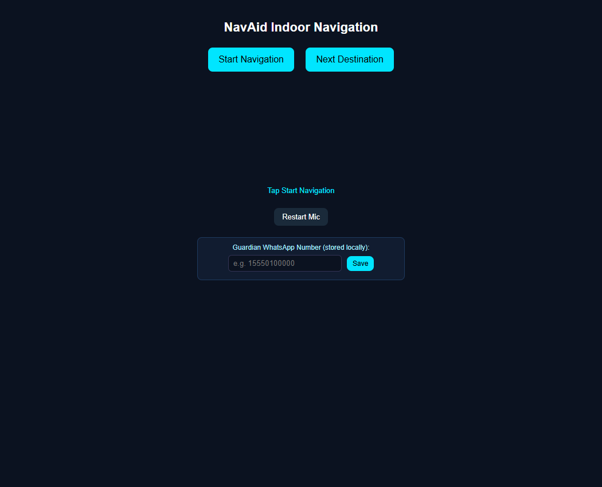

*Isolated application capture before access to device sensors or media.*

---

## Problem Statement & Proposed Solution

Standard GPS fails inside multi-corridor buildings like hospitals, leaving visually impaired visitors unable to read signage, detect sudden path obstructions, or quickly share context with a guardian during an emergency.

NaviAid addresses this using zero-install smartphone browser APIs:
1. **Optical QR Indoor Positioning (`jsQR`):** Scans printed entrance, corridor, and department markers without costly BLE beacons or indoor hardware.
2. **Hands-Free Voice & Haptic Loop (`Web Speech API` + `Vibration API`):** Speaks turn-by-turn step counts and listens continuously for destination commands, facility schedule queries, and spoken distress triggers.
3. **Resilient Wrong-Way Recovery:** Automatically detects skipped markers (snapping step progress cleanly) or wrong-branch turns (constructing two-leg recovery instructions via the central `junction`).
4. **Multi-Trigger Safety Net:** Combines voice SOS, hardware Volume / 3-finger touch holds, and accelerometer fall detection with single-shot GPS Google Maps links, prefilled WhatsApp click-to-chat drafts, and WebRTC live camera/microphone streaming via PeerJS.

---

## System Architecture

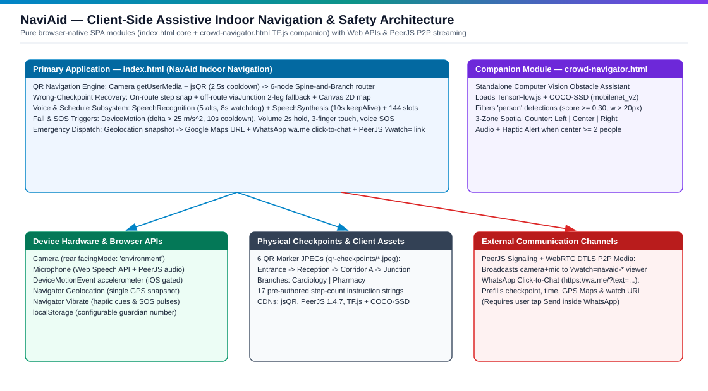

See [`docs/ARCHITECTURE_AND_NAVIGATION.md`](docs/ARCHITECTURE_AND_NAVIGATION.md) for component boundaries and browser API dependencies.

---

## Core Implemented Features

### 1. Spine-and-Branch Indoor Routing & QR Checkpoints
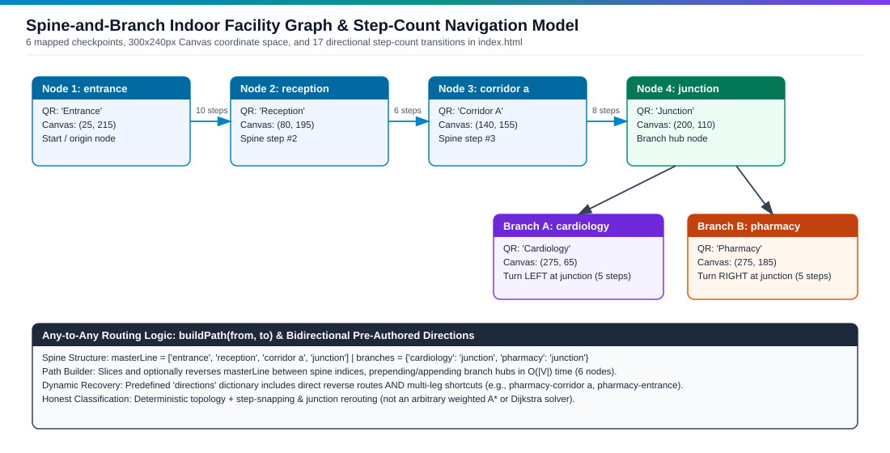

- **Facility Graph:** Models a 4-node central corridor (`entrance` ↔ `reception` ↔ `corridor a` ↔ `junction`) with two branch destinations (`cardiology`, `pharmacy`) and `17` pre-authored directional step-count transitions rendered on a `300x240px` HTML5 `<canvas>` mini-map.
- **Any-to-Any Path Builder (`buildPath(from, to)`):** Supports direct navigation from any scanned node to any other node (e.g., `cardiology` → `junction` → `pharmacy`) in $O(|V|)$ time.

### 2. Dynamic Wrong-Checkpoint Recalculation (`handleQR()`)
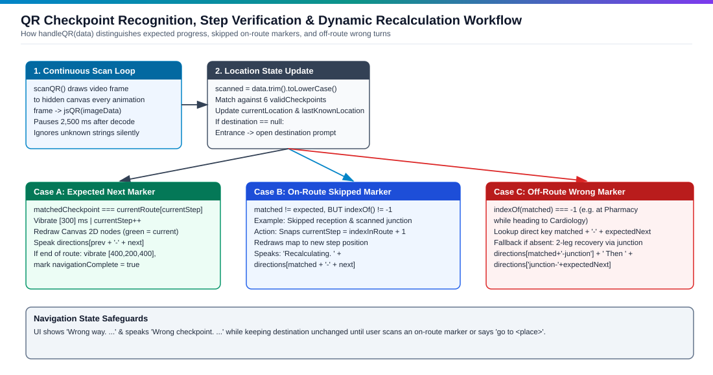

- **On-Route Skip Recovery:** If a user bypasses `reception`/`corridor a` and scans `junction`, `handleQR()` snaps `currentStep` forward and speaks `"Recalculating. <next instruction>"`.
- **Off-Route Branch Recovery:** If a user heads toward `cardiology` but accidentally scans `pharmacy`, `handleQR()` synthesizes a two-leg `viaJunction` path back to `junction` and onward (`"Wrong checkpoint. Walk five steps back to the junction Then Turn left..."`).
- **Debouncing & Safety:** Applies a `2,500 ms` scan cooldown (`scanning = false` timer) and silently ignores unrecognized QR strings.

### 3. Voice Interaction & 24-Hour Cyclic Schedule Assistant
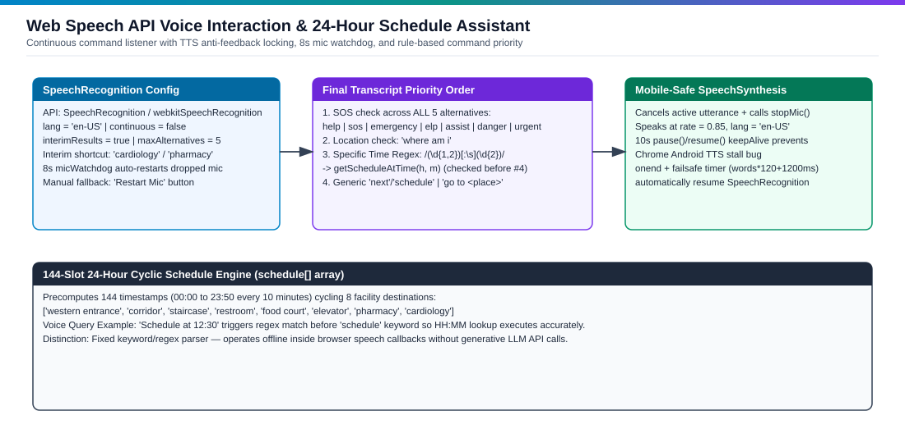

- **Mobile-Hardened Speech Loop:** Stops `SpeechRecognition` prior to utterance playback (`SpeechSynthesis` at `rate = 0.85`), uses a `10 s` `pause()/resume()` keepAlive loop for Chrome Android TTS stability, and runs an `8 s` microphone watchdog + `Restart Mic` button.
- **Supported Commands:** Destination selection (`"cardiology"`, `"pharmacy"`), re-routing (`"go to <node>"` / `"take me to <node>"`), `"where am i"`, and time/schedule lookup (`"next"`, `"schedule"`, or `"schedule at HH:MM"` prioritizing time regex before generic keywords) against **144** generated 10-minute facility slots across 8 locations.

### 4. Emergency SOS, Fall Detection & WhatsApp Alerts
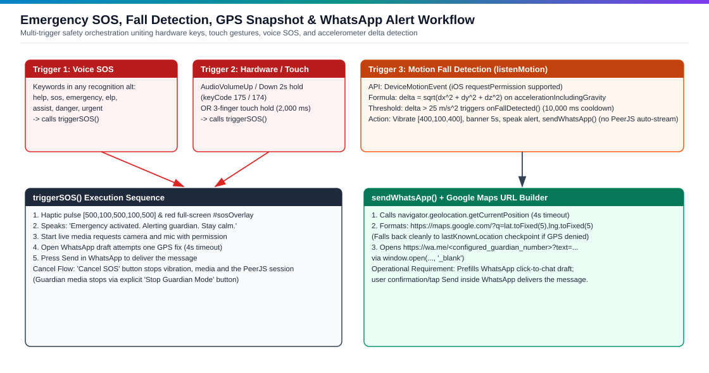

- **Three SOS Triggers (`triggerSOS()`):**
  - **Voice Keywords:** Checks all `5` recognition alternatives for `"help"`, `"sos"`, `"emergency"`, `"elp"`, `"assist"`, `"danger"`, or `"urgent"`.
  - **Hardware Long-Press:** `2,000 ms` hold on `AudioVolumeUp` or `AudioVolumeDown` (`keyCode 175`/`174`).
  - **Touch Gesture:** `2,000 ms` 3-finger screen hold (`e.touches.length === 3`).
- **Motion-Based Fall Detection (`listenMotion()`):** Reads `DeviceMotionEvent` `accelerationIncludingGravity` (with iOS `requestPermission()` support) and triggers `onFallDetected()` when sample-to-sample Euclidean delta $\sqrt{\Delta x^2 + \Delta y^2 + \Delta z^2} > 25\text{ m/s}^2$, protected by a `10,000 ms` cooldown. *(Prototype threshold — not medically validated.)*
- **GPS + WhatsApp Click-to-Chat (`sendWhatsApp()`):** Acquires a single GPS fix (`toFixed(5)`), formats `https://maps.google.com/?q=lat,lng` (falling back to `lastKnownLocation` checkpoint if GPS fails), and opens a prefilled `https://wa.me/<guardian_number>?text=...` draft *(user taps Send inside WhatsApp)*. Guardian phone numbers are stored in browser `localStorage` (`navaid_guardian_number`) via the UI input—never hardcoded in this public repo.

Cancel ends media sharing and discards pending SOS callbacks. Watch links are bearer links. Use consenting test devices and keep links private.

### 5. Guardian Live Camera & Audio Streaming (`PeerJS` WebRTC P2P)
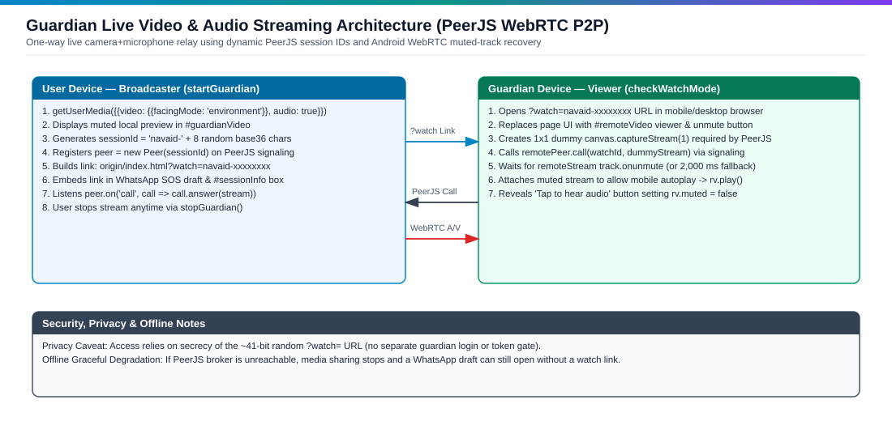

- SOS opens a local alert. **Start live camera and microphone** requests permission and creates an optional PeerJS watch link. **Open WhatsApp draft** can include that link and a single GPS fix. The sender confirms delivery in WhatsApp by pressing Send.
- When opened with `?watch=...`, `checkWatchMode()` renders a dedicated `#remoteVideo` viewer using a `1x1` dummy `<canvas>.captureStream(1)` track required by PeerJS `call()`, handles Android WebRTC initial muted tracks (`track.onunmute` + `2,000 ms` fallback), and displays an explicit **"Tap to hear audio"** unmute button.

### 6. Companion Crowd Density Vision Module (`crowd-navigator.html`)
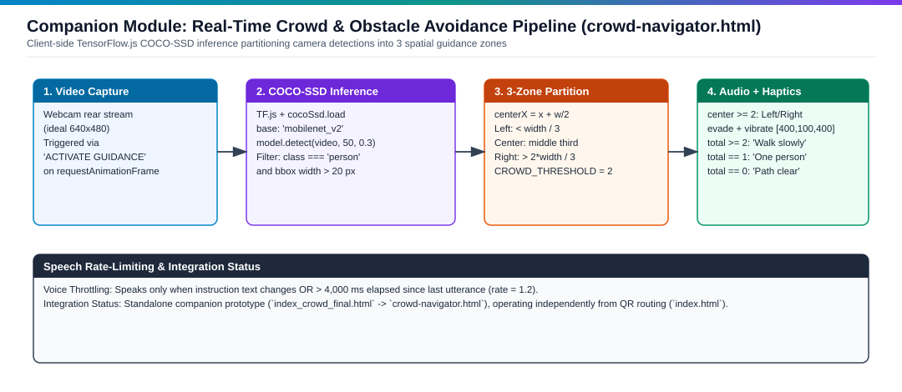

A standalone TensorFlow.js (`@tensorflow/tfjs` + `@tensorflow-models/coco-ssd`, `mobilenet_v2` at `0.30` confidence) webcam module that partitions detected `person` bounding boxes (`width > 20 px`) into `left`, `center`, and `right` camera zones and issues throttled (`4 s`) voice & vibration guidance when `center >= 2` (`"Crowd ahead. Clearer on the left/right."`).

---

## Application Walkthrough & Screenshots

All UI screenshots below were captured from the local application (`index.html` / `crowd-navigator.html` over `http://127.0.0.1` using a synthetic camera stream and test contact `15550100000`), alongside a real-device WhatsApp SOS alert capture. Full capture notes are in [`docs/APPLICATION_DEMONSTRATION.md`](docs/APPLICATION_DEMONSTRATION.md).

### 1. Indoor QR Navigation & Wrong-Checkpoint Recovery

| Active Navigation (`Entrance` → `Cardiology`) | Off-Route Wrong-Checkpoint Recovery (`Pharmacy` scanned) | Destination Reached (`Cardiology`) |
|---|---|---|
| 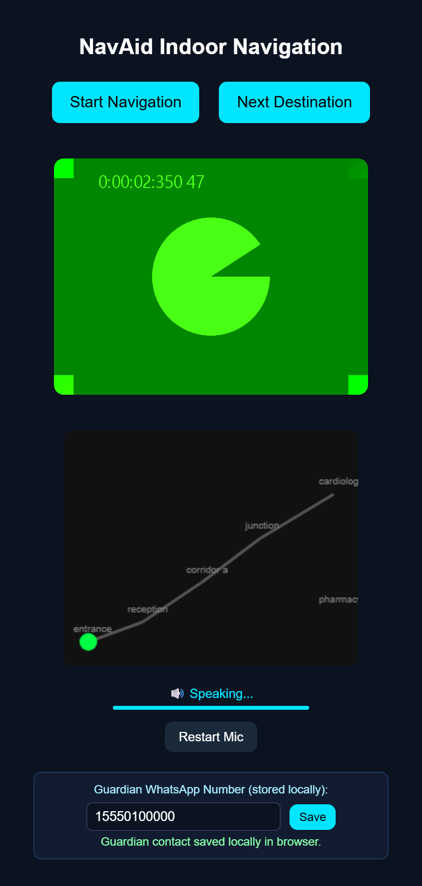 | 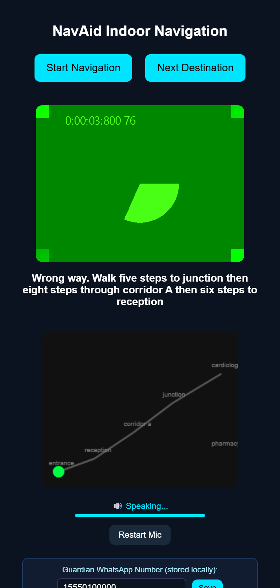 | 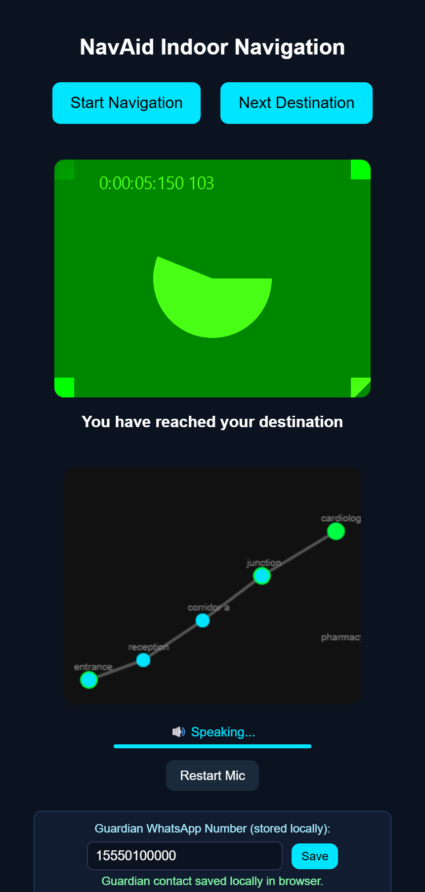 |
| *Mini-map `<canvas>` highlighting `entrance` with voice output active.* | *Detects wrong branch and guides user back via `junction`.* | *Marks completed checkpoints along the path to `cardiology`.* |

### 2. Emergency SOS, WhatsApp GPS Alert & Companion Modules

| SOS Emergency Modal | Real-Device WhatsApp SOS Alert | Guardian Watch Mode (`?watch=`) | Crowd Navigator (`crowd-navigator.html`) |
|---|---|---|---|
| 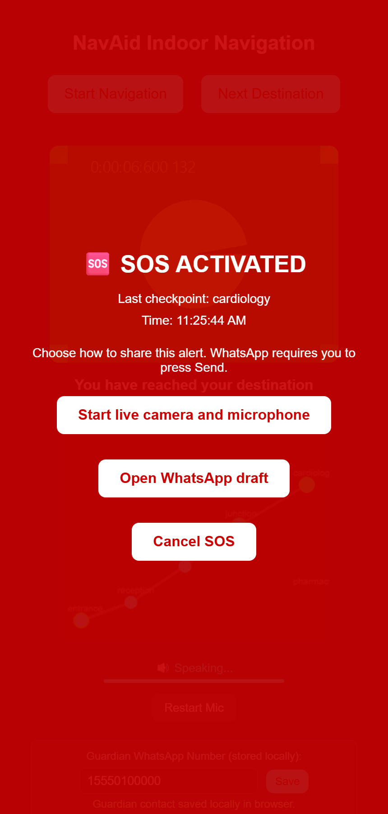 | 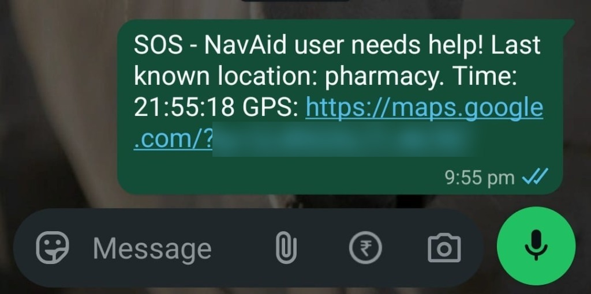 | 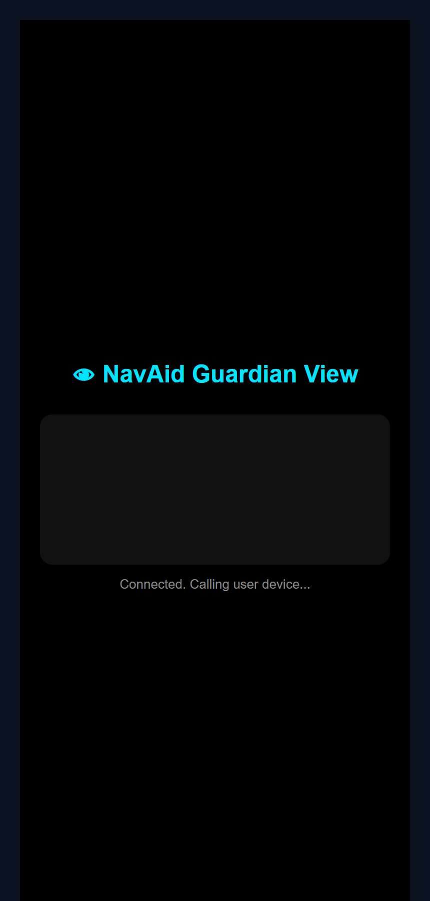 | 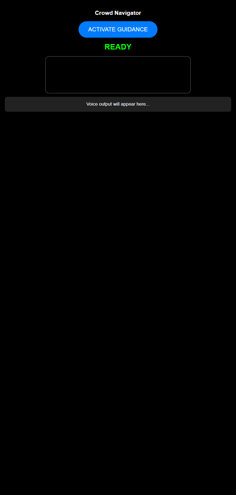 |
| *Consented sharing controls: live WebRTC media, WhatsApp draft, or Cancel SOS.* | *Real-device WhatsApp alert showing last checkpoint (`pharmacy`), timestamp, and Google Maps GPS link.* | *PeerJS remote viewer displaying live guardian connection state.* | *Standalone TensorFlow.js / COCO-SSD 3-zone crowd avoidance UI.* |

---

## Technology Stack (Code-Verified)

| Layer | Technologies Actually Used in Code | Proposed in Slides (`HACKATHON.pptx`) *(Not in Code)* |
|---|---|---|
| **Core App (`index.html`)** | HTML5, CSS3, Vanilla JS, HTML5 Canvas 2D | React/Node backend *(not required)* |
| **QR Recognition** | `jsQR` (CDN) scanning video frames on `<canvas>` + 6 JPEG markers | BLE Beacons |
| **Routing Engine** | 6-node Spine-and-Branch `buildPath()` + 17 step strings + `viaJunction` rerouting | A* shortest-path search, JSON DB |
| **Voice & Feedback** | Web Speech API (`SpeechRecognition`, `SpeechSynthesis`), `navigator.vibrate()` | — |
| **Sensors & Location** | `DeviceMotionEvent`, `navigator.geolocation` (single GPS snapshot), Google Maps `?q=` | — |
| **Live Media & Alerts** | **PeerJS `1.4.7`** (WebRTC P2P), WhatsApp Click-to-Chat (`wa.me`), `localStorage` | — |
| **Obstacle Vision (`crowd-navigator.html`)** | TensorFlow.js + `@tensorflow-models/coco-ssd` (`mobilenet_v2`) | TensorFlow Lite / YOLO |

---

## QR Checkpoint Demonstration Set (`qr-checkpoints/`)

| Node ID | Marker File | Decoded QR Text | Role in Topology |
|---|---|---|---|
| `entrance` | [`qr-checkpoints/entrance.jpeg`](qr-checkpoints/entrance.jpeg) | `Entrance` | Mandatory starting node (`(25, 215)`) |
| `reception` | [`qr-checkpoints/reception.jpeg`](qr-checkpoints/reception.jpeg) | `Reception` | Spine checkpoint 2 (`(80, 195)`) |
| `corridor a` | [`qr-checkpoints/corridor-a.jpeg`](qr-checkpoints/corridor-a.jpeg) | `Corridor A` | Spine checkpoint 3 (`(140, 155)`) |
| `junction` | [`qr-checkpoints/junction.jpeg`](qr-checkpoints/junction.jpeg) | `Junction` | Branch hub (`(200, 110)`) |
| `cardiology` | [`qr-checkpoints/cardiology.jpeg`](qr-checkpoints/cardiology.jpeg) | `Cardiology` | North branch (`(275, 65)`) |
| `pharmacy` | [`qr-checkpoints/pharmacy.jpeg`](qr-checkpoints/pharmacy.jpeg) | `Pharmacy` | South branch (`(275, 185)`) |

See [`qr-checkpoints/README.md`](qr-checkpoints/README.md) for a step-by-step tabletop or printed demo walkthrough (normal path + skipped checkpoint + off-route wrong turn).

---

## Local Setup, Demonstration & Testing

Because camera, microphone, geolocation, and `DeviceMotion` APIs require a **secure context (`https://` or `http://localhost`)**, serve the repository over a local HTTP server:

```bash
# Option A: Using Node.js (serve current directory)
npx --yes serve . --listen 8080

# Option B: Using Python 3 built-in HTTP server
python -m http.server 8080 --bind 127.0.0.1
```

1. Open `http://localhost:8080/index.html` (or `http://localhost:8080/crowd-navigator.html` for the TF.js crowd vision companion).
2. Configure a test **Guardian WhatsApp Number** in the browser input box (saved only to your local browser `localStorage`).
3. Click **Start Navigation**, grant Camera & Microphone permissions, and hold [`qr-checkpoints/entrance.jpeg`](qr-checkpoints/entrance.jpeg) in front of the camera (either printed or displayed on a second phone/screen).

### Automated Unit & Logic Tests (Node.js `>=20`)

```bash
npm test
# Runs: node --test tests/*.test.mjs (8/8 tests passing in sandboxed VM)
```

Verifies the 144-slot schedule generator, full sequential QR routing (`entrance` → `cardiology`), on-route skipped step snapping (`"Recalculating..."`), off-route branch `viaJunction` rerouting (`"Wrong checkpoint..."`), synthetic `DeviceMotionEvent` normal vs. `delta > 25` fall spike + `10 s` cooldown, and SOS / cancel state transitions without triggering real alerts.

---

## Repository Structure

```text
.
├── index.html                  # Primary NaviAid app (QR routing, voice, fall, SOS, PeerJS Guardian)
├── crowd-navigator.html        # Companion TensorFlow.js COCO-SSD 3-zone crowd avoidance prototype
├── package.json                # Node test runner script (`npm test`)
├── AUTHORS.md                  # Developer & hackathon context attribution
├── .gitignore
├── qr-checkpoints/             # 6 decoded QR JPEG markers + demonstration guide
├── assets/
│   ├── diagrams/               # 7 XML-validated source-grounded SVG architecture & flow diagrams
│   └── screenshots/            # 8 verified application & real-device SOS screenshots
├── docs/                       # Deep technical & demonstration documentation (6 guides)
└── tests/
    └── naviaid.test.mjs        # Automated Node VM verification suite (8/8 passing)
```

---

## Known Limitations & Future Scope

- **Known Limitations:** Fixed 6-node hospital layout (no dynamic weighted A* map editor); `SpeechRecognition` requires Chromium-based browsers and microphone quietness; WhatsApp `wa.me` opens a prefilled draft requiring manual Send confirmation (and popups may be blocked if triggered asynchronously); `DeviceMotionEvent` (`delta > 25`) is a simple threshold prototype that pauses when the browser tab/screen is locked; `?watch=` PeerJS links rely on link secrecy without login authentication; `crowd-navigator.html` runs standalone rather than merged into `index.html`.
- **Future Scope:** Unify COCO-SSD obstacle alerts into `index.html`, migrate routing to dynamic GeoJSON/weighted graph A*, add authenticated WebRTC TURN relays and encrypted guardian sessions, and configure automated multi-channel emergency dispatch.

---

Likhith B developed and maintains NaviAid. See [authorship and hackathon attribution](AUTHORS.md).

## Documentation Index

| Document | Contents |
|---|---|
| [`docs/ARCHITECTURE_AND_NAVIGATION.md`](docs/ARCHITECTURE_AND_NAVIGATION.md) | Dual-module architecture, 6-node spine-and-branch routing, `handleQR()` rerouting, 144-slot schedule |
| [`docs/EMERGENCY_SAFETY_AND_GUARDIAN.md`](docs/EMERGENCY_SAFETY_AND_GUARDIAN.md) | 3 SOS triggers, Euclidean fall detection (`> 25 m/s^2`), GPS/WhatsApp click-to-chat, PeerJS streaming & privacy |
| [`docs/VOICE_AND_CROWD_VISION.md`](docs/VOICE_AND_CROWD_VISION.md) | Web Speech commands, Android keepAlive/watchdog, TensorFlow.js COCO-SSD 3-zone pipeline |
| [`docs/LOCAL_SETUP_AND_VERIFICATION.md`](docs/LOCAL_SETUP_AND_VERIFICATION.md) | HTTPS/localhost permissions, desktop vs. Android/iOS compatibility, Node test suite evidence |
| [`docs/HACKATHON_CONTEXT.md`](docs/HACKATHON_CONTEXT.md) | Presentation (`HACKATHON.pptx`) vs. implementation reconciliation & version evolution |
| [`docs/APPLICATION_DEMONSTRATION.md`](docs/APPLICATION_DEMONSTRATION.md) | Screenshot evidence register, capture conditions & privacy sanitization notes |
| [`qr-checkpoints/README.md`](qr-checkpoints/README.md) | Offline QR testing scenarios (normal route, skipped checkpoint, wrong branch) |
| [`AUTHORS.md`](AUTHORS.md) | Authorship ([Likhith B](https://github.com/LikhithB05)), team status & licensing notes |
