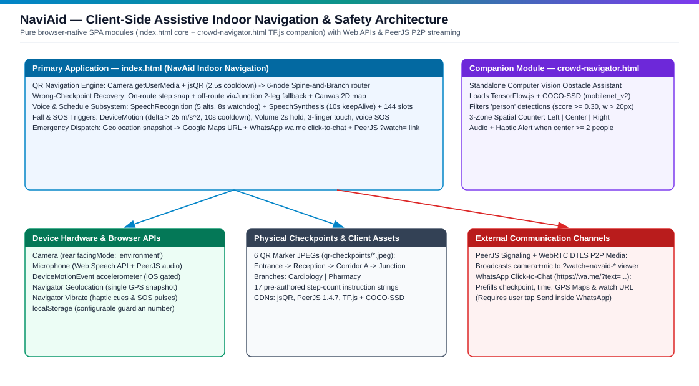
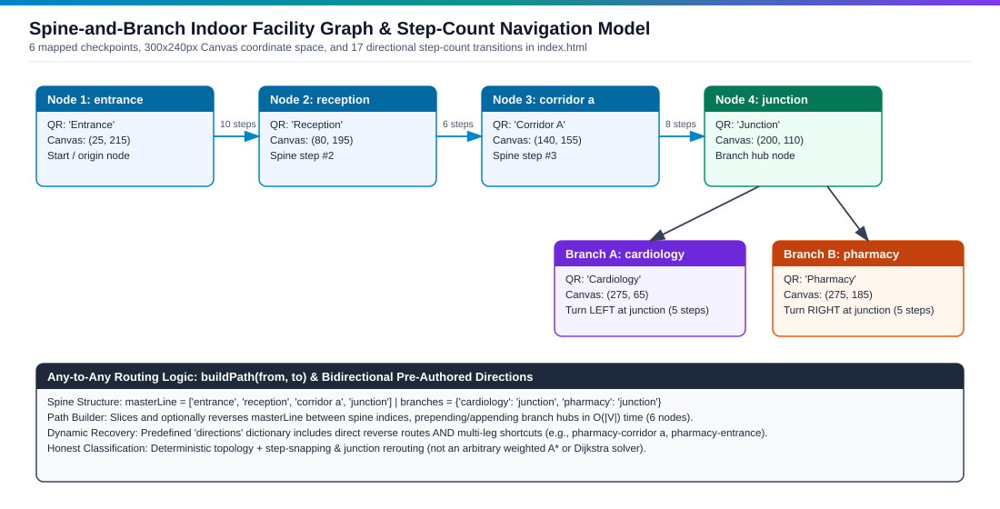
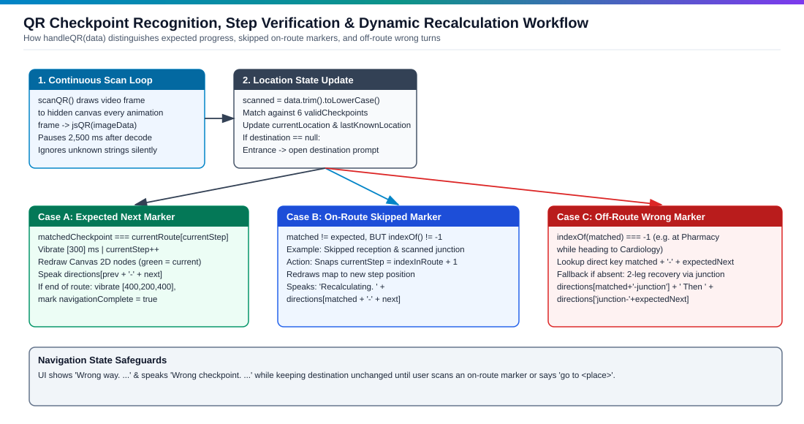

# Architecture, Indoor Navigation & Dynamic Rerouting

## 1. Spine-and-Branch Routing Data Model (`index.html`)

- **Spine:** `masterLine = ["entrance", "reception", "corridor a", "junction"]`
- **Branches:** `branches = { "cardiology": "junction", "pharmacy": "junction" }`
- **Checkpoints (`validCheckpoints`):** `["entrance", "reception", "corridor a", "junction", "cardiology", "pharmacy"]`
- **Instructions (`directions`):** `17` pre-authored string transitions pairing `"from-to"` keys with human step counts (e.g., `"entrance-reception": "Walk forward ten steps to reception"`, `"cardiology-reception": "Walk five steps to junction then eight steps through corridor A then six steps to reception"`).

## 2. Any-to-Any Routing Algorithm (`buildPath(from, to)`)

`buildPath()` computes paths in $O(|V|)$ time without heuristic search overhead:
1. **Both on spine (`masterLine`):** Returns `masterLine.slice(...)` forward or `.reverse()` backward.
2. **Branch -> Spine:** Prepends `[from]` and slices `masterLine` from `branches[from]` (`"junction"`) to `to`.
3. **Branch -> Branch:** Connects `from` -> `branches[from]` -> spine segment -> `branches[to]` -> `[to]`.
4. **Spine -> Branch:** Slices `masterLine` from `from` to `branches[to]` (`"junction"`) and appends `[to]`.

## 3. Runtime Wrong-Checkpoint Handling (`handleQR(data)`)

1. Normalizes decoded QR payload (`data.trim().toLowerCase()`) and matches against `validCheckpoints` via `.includes(cp)`. Invalid QR payloads return silently without crashing.
2. Updates both `currentLocation` and `lastKnownLocation` immediately so any subsequent SOS/Fall event reports the latest scanned node.
3. Compares `matchedCheckpoint` against `expectedCheckpoint = currentRoute[currentStep]`:
   - **Exact match:** Vibrates `[300]`, increments `currentStep`, updates Canvas 2D map, speaks next instruction (or announces destination arrival when `currentStep === currentRoute.length`).
   - **On-route jump (`indexOf !== -1`):** Snaps `currentStep = indexInRoute + 1` and speaks `"Recalculating. " + instruction`.
   - **Off-route error (`indexOf === -1`):** Checks direct `directions[matched + "-" + expectedNext]`; if absent, synthesizes `directions[matched + "-junction"] + " Then " + directions["junction-" + expectedNext]` and speaks `"Wrong checkpoint. " + instruction`.

## 4. Built-In 24-Hour Cyclic Schedule Helper

At page load, `index.html` precomputes `144` schedule entries (`00:00`–`23:50` at `10`-minute intervals) cycling `8` labels (`"western entrance"`, `"corridor"`, `"staircase"`, `"restroom"`, `"food court"`, `"elevator"`, `"pharmacy"`, `"cardiology"`), queried via `askSchedule()` or `getScheduleAtTime(h, m)`.
