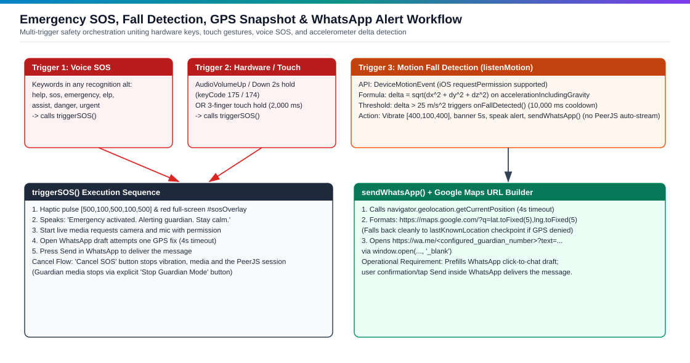
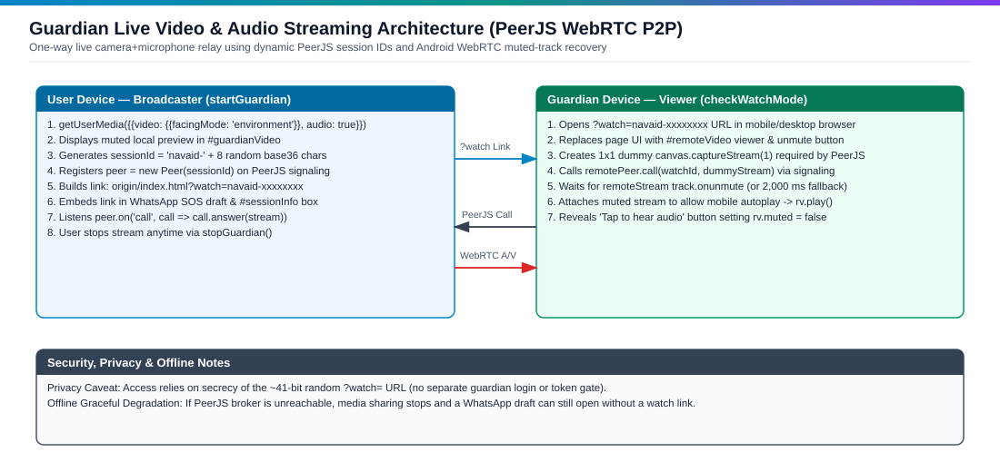

# Emergency SOS, Fall Detection & PeerJS Guardian Streaming

## 1. Multi-Trigger SOS Orchestration (`triggerSOS()`)

| Trigger | Detection Mechanism | Activation Delay / Condition |
|---|---|---|
| **Voice SOS** | `SpeechRecognition` checks all `5` alternatives | Immediate when any transcript contains `help`, `sos`, `emergency`, `elp`, `assist`, `danger`, or `urgent` |
| **Volume Long-Press** | `keydown` / `keyup` (`AudioVolumeUp`/`AudioVolumeDown`, `keyCode` `175`/`174`) | `2,000 ms` sustained hold |
| **3-Finger Touch Hold** | `touchstart` (`e.touches.length === 3`) | `2,000 ms` sustained touch |

SOS presents local guidance and vibration. Camera and microphone capture requires the explicit Start live camera and microphone action. Open WhatsApp draft is separate and can include a checkpoint, one GPS fix and the active watch link. Send requires confirmation in WhatsApp. Cancel stops guardian tracks, destroys the peer and invalidates pending SOS and media callbacks.

## 2. Motion-Based Fall Detection (`listenMotion()`)

Uses `DeviceMotionEvent` (`accelerationIncludingGravity`, requesting iOS permission when `DeviceMotionEvent.requestPermission` exists):

$$\Delta = \sqrt{(a_x - a_{x,\text{prev}})^2 + (a_y - a_{y,\text{prev}})^2 + (a_z - a_{z,\text{prev}})^2}$$

- Triggers `onFallDetected()` if $\Delta > 25\text{ m/s}^2$ and `!fallCooldown`, then enforces a `10,000 ms` cooldown.
- Flashes `#fallAlert` for `5 s`, speaks alert, vibrates `[400,100,400]`, and opens a GPS-tagged WhatsApp alert draft.

## 3. Geolocation, WhatsApp Click-to-Chat & Security Notes

- **GPS Snapshot:** Uses one-shot `navigator.geolocation.getCurrentPosition()` (`toFixed(5)`) to generate `https://maps.google.com/?q=lat,lng` (NOT background tracking).
- **WhatsApp Delivery:** Uses `window.open("https://wa.me/" + GUARDIAN_NUMBER + "?text=...", "_blank")`. Requires Guardian phone configuration (saved in browser `localStorage`) and manual Send confirmation inside WhatsApp.
- **PeerJS Watch Links (`?watch=navaid-...`):** Streams camera + audio one-way over WebRTC DTLS using PeerJS `1.4.7`. Access depends on link secrecy (random IDs are not gated behind user login). Stop streaming anytime via **Stop Guardian Mode** (`stopGuardian()`).
