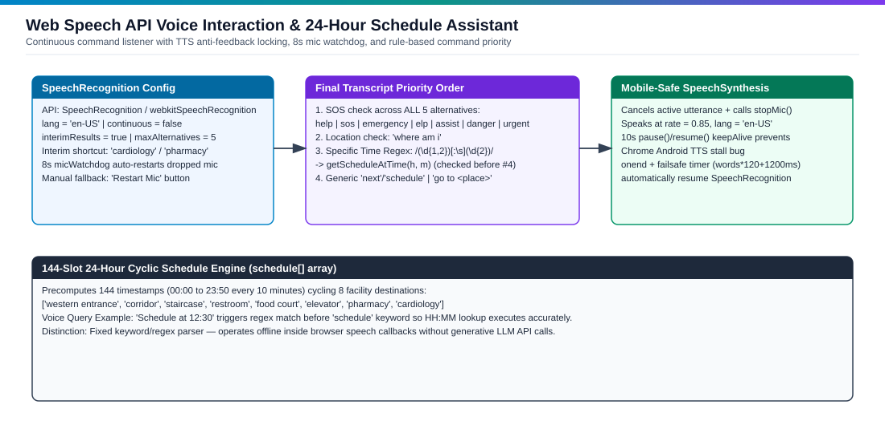
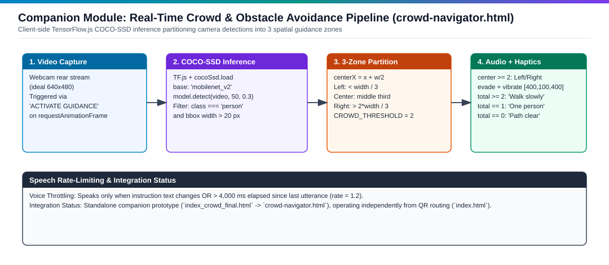

# Voice Assistance & Companion Crowd Vision Module

## 1. Web Speech Recognition & Synthesis (`index.html`)

- **Microphone Watchdog & Anti-Feedback:** `speak()` cancels prior utterances, calls `stopMic()` while speaking, restarts recognition via `onend` + calculated fallback timer (`wordCount * 120 + 1200 ms`), and schedules a `10,000 ms` `pause()/resume()` keepAlive interval for Chrome Android TTS reliability. `startMic()` maintains an `8,000 ms` watchdog interval to recover from dropped recognition sessions.
- **Parser Priority Order (`recognition.onresult`):**
  1. SOS keywords across all `5` recognition alternatives (`help`, `sos`, `emergency`, `elp`, `assist`, `danger`, `urgent`).
  2. Location query (`"where am i"`).
  3. Specific time regex `/(\d{1,2})[:\s](\d{2})/` (evaluated **before** `"next"`/`"schedule"` so `"schedule at 12:30"` reaches `getScheduleAtTime(12, 30)` cleanly).
  4. Generic `"next"` / `"schedule"` or `"go to"` / `"navigate to"` / `"take me to"` commands.

## 2. Companion Crowd Navigator (`crowd-navigator.html`)

- Independent HTML5 prototype powered by `@tensorflow/tfjs` + `@tensorflow-models/coco-ssd` (`mobilenet_v2`, score threshold `0.30`, min box width `20 px`).
- Classifies detected `person` boxes horizontally into `left`, `center`, and `right` thirds (`w / 3`, `2w / 3`):
  - `center >= 2` -> red status + vibrate `[400,100,400]` + `"Crowd ahead. Clearer on the left/right."`
  - `total >= 2` -> yellow status + `"Approaching a crowd. Walk slowly."`
  - `total === 1` -> `"One person ahead."` | `0` -> green `"Path clear."`
- Rate-limits spoken prompts to avoid repeats within `4,000 ms`.
